

  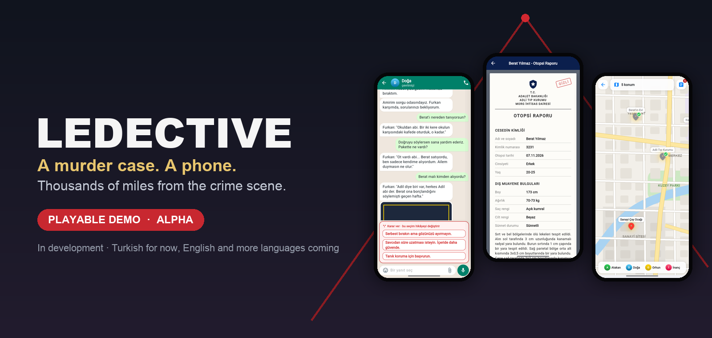

  
  &nbsp;
  

  
  
  

# Ledective

**A detective game that happens entirely inside a phone.**

You are a homicide commissioner on leave, somewhere far away. The phone
buzzes: Berat Yılmaz, a university student and the son of a member of
parliament, has been found hanged in his flat. Everyone wants to write it
off as suicide. Your team doesn't think so, and neither will you.

There is no flight home for days. All you have is your phone: your team's
group chats, the police document system, a city map, a bank app, the news,
and a social network full of people who post more than they should. Read
between the lines, send your officers into the field, put the evidence on
the board and decide who to trust. Every answer you choose is remembered.

> [!WARNING]
> **This is a playable demo, and Ledective is still in development.**
> Expect bugs, rough edges, placeholder images and parts of the story that
> will be rewritten. Saves from this demo may not carry over to later
> versions. Feedback is very welcome (see [below](#feedback)).

> [!NOTE]
> **The game is in Turkish for now.** All story text, chats and documents
> in this demo are Turkish. **English and more languages are coming in
> later versions.**

## Download and play

| Where | How | |
|---|---|---|
| **Android** (7.0 or newer) | Download `Ledective-demo-0.5.0-alpha.apk` from the latest release and open it. | [**Download APK**](https://github.com/Erimsaholut/ledective-demo/releases/latest) |
| **Any browser** (iPhone, iPad, computer) | Open the link and play. On iPhone, *Share › Add to Home Screen* makes it feel like an app. | [**ledective.web.app**](https://ledective.web.app) |
| iPhone app | Not available yet. Use the browser version. | |

<b>Installing the APK on Android</b>

1. Download the APK from the [latest release](https://github.com/Erimsaholut/ledective-demo/releases/latest).
2. Open it. Android will ask whether to allow installs from this source
   (your browser or file manager). Allow it for this install.
3. Tap **Install**. Ledective appears among your apps.

The APK is not from Google Play, which is why Android asks. It needs no
special permissions to play; the in-game camera asks only if you open it.

## How you play

<table>
  <tr>
    <td width="33%">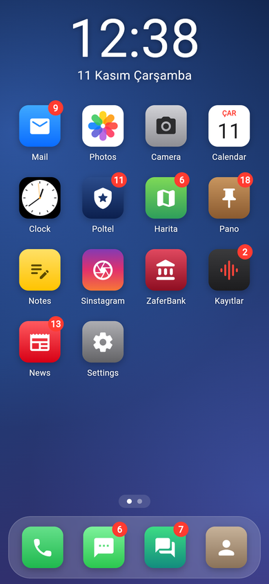</td>
    <td width="33%">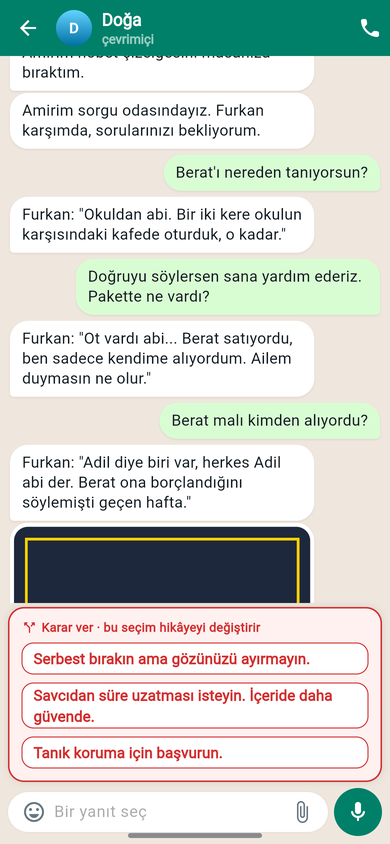</td>
    <td width="33%">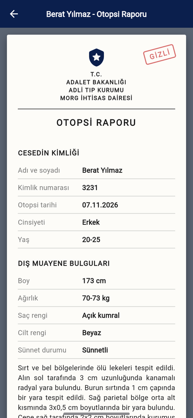</td>
  </tr>
  <tr>
    <td><b>The phone is the game.</b> Notifications arrive while you play. New messages, mail, voicemail and news come in as the case moves.</td>
    <td><b>Choose what to say.</b> Run interrogations from the other side of the world. Some answers are decisions, and they change the story.</td>
    <td><b>Read the files.</b> Statements, reports and personnel records land in Poltel, the police document system. Look for what doesn't add up.</td>
  </tr>
  <tr>
    <td>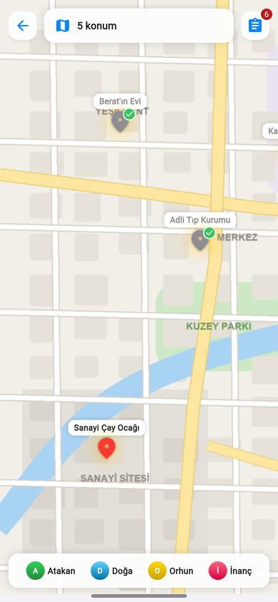</td>
    <td>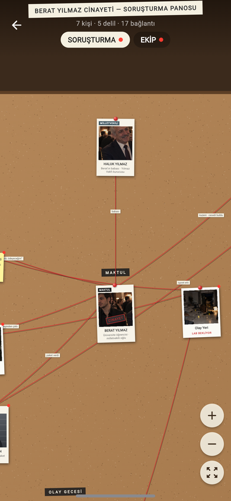</td>
    <td>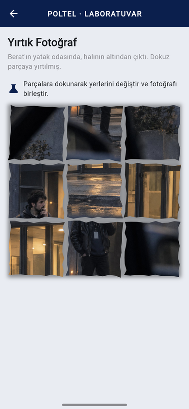</td>
  </tr>
  <tr>
    <td><b>Send your team.</b> Officers go out to places you've learned about. Missions take real time, and their reports open new leads.</td>
    <td><b>Build the board.</b> People, evidence and the timeline of the night hang on the board, tied together with red string.</td>
    <td><b>Work the evidence.</b> In the lab, put torn photos back together, match fingerprints and search pages under UV light.</td>
  </tr>
  <tr>
    <td>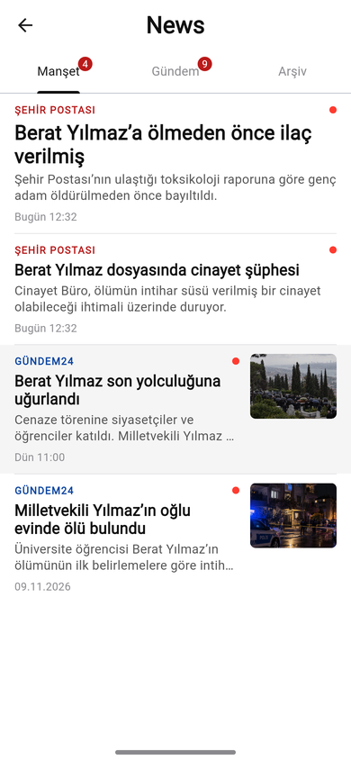</td>
    <td>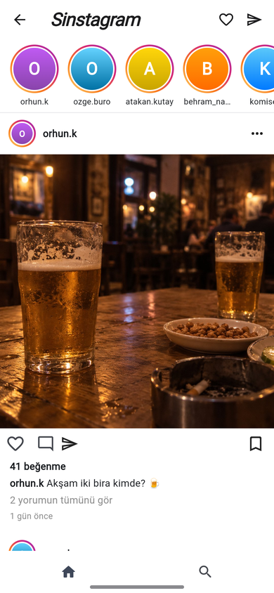</td>
    <td>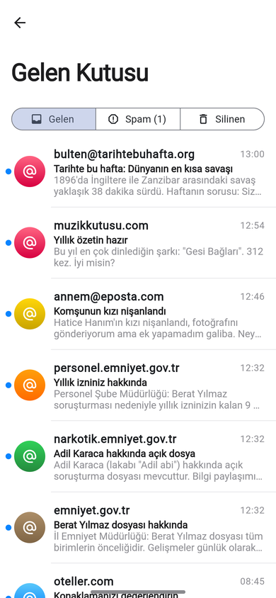</td>
  </tr>
  <tr>
    <td><b>Follow the news.</b> Headlines change as the case does. Search the archive for names and places, years back.</td>
    <td><b>Search social media.</b> Suspects don't show up in your feed. Learn a name, then go looking.</td>
    <td><b>Check your inbox.</b> Official mail, tips and ordinary life, side by side. Not everything that arrives is true.</td>
  </tr>
</table>

### What makes it different

- **No map of the mystery.** Nothing tells you where the next clue is. A
  report only says that there is *something* worth a look.
- **Choices with weight.** Who you protect, what you report, what you keep
  quiet about, and what you do with money that turns up in your account.
- **Your detective has a character.** Every choice adds to traits such as
  anger, mercy and curiosity. The story keeps track of who you've become.
- **Real time.** Field missions and some events run on a clock, and the
  team keeps working while you're away.
- **Several endings.** The demo ends with a summary of the decisions that
  shaped your case.

## A phone with a life of its own

It's a whole phone, so there is more on it than the case. Install games from
the in-game **AppShop** and take a break:

<table>
  <tr>
    <td width="25%">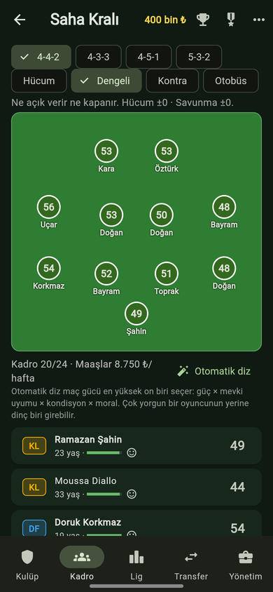</td>
    <td width="25%">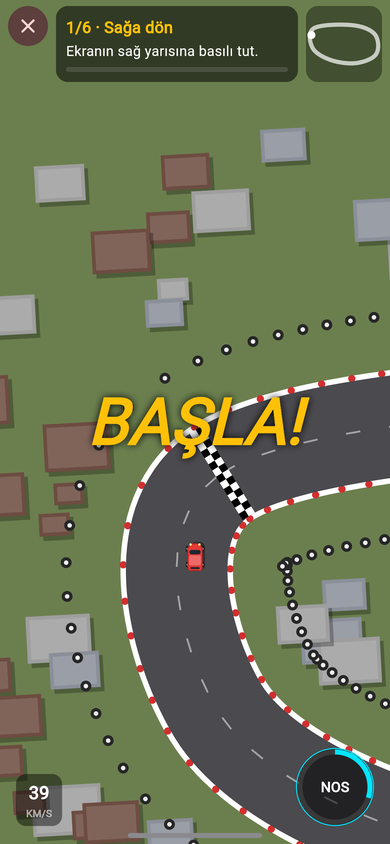</td>
    <td width="25%">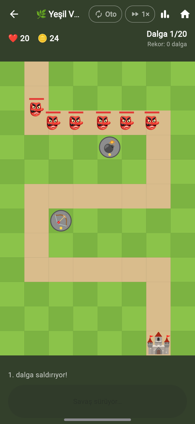</td>
    <td width="25%">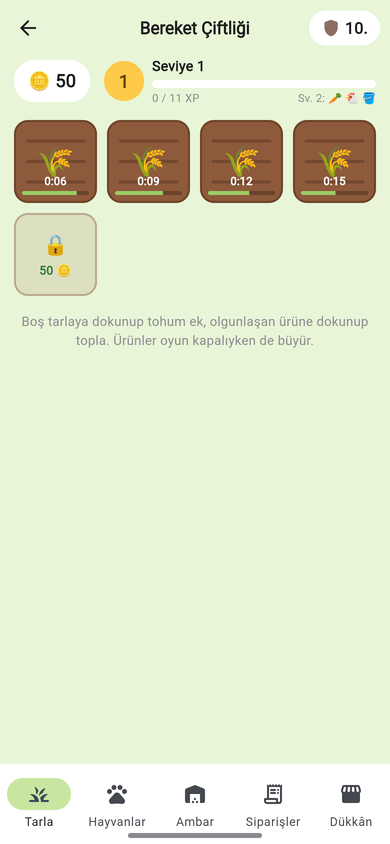</td>
  </tr>
  <tr>
    <td><b>Saha Kralı</b> Football manager. Take a small-town club from the fourth tier to the top of Europe: transfers and loans with real haggling, staff, tactics, a board that loses patience, and some offers you should probably refuse.</td>
    <td><b>Pist Canavarı</b> Racing. Top-down street races with drifting, nitro, a garage and rivals across several cups.</td>
    <td><b>Kale Muhafızı</b> Tower defence. Build archer, cannon and ice towers along the road and hold your castle against goblins, giants and dragons, then try the endless mode.</td>
    <td><b>Bereket Çiftliği</b> Farming. Plant and harvest, raise chickens, cows, sheep and bees, fill your neighbours' orders and climb the village league. Crops keep growing while the game is closed.</td>
  </tr>
</table>

**...and more:** Solitaire, Sudoku, nonograms and other puzzles, a piano,
a music player, a calculator, a camera, notes, a calendar, and new games
on the way.

## What's in this demo

- The case from the first message to the demo's ending.
- The core apps: chats, documents and the lab, map missions, the evidence
  board, news, social media, the bank, mail and voicemail.
- The side games above, and more.

Still in progress: some chapters are drafts, some images are placeholders,
and parts of the story will change.

## Feedback

Found a bug, got stuck, or have an opinion? Please
[open an issue](https://github.com/Erimsaholut/ledective-demo/issues/new).
It helps to say which version you played (Android or browser) and roughly
where you were in the story. Please keep spoilers out of issue titles.

## About this repository

This repository only hosts the demo builds and this page. The game's source
code is private.

© 2026 Erimsaholut. All rights reserved. Ledective is a work of fiction.
Any resemblance to real people, organisations or events is coincidental.
